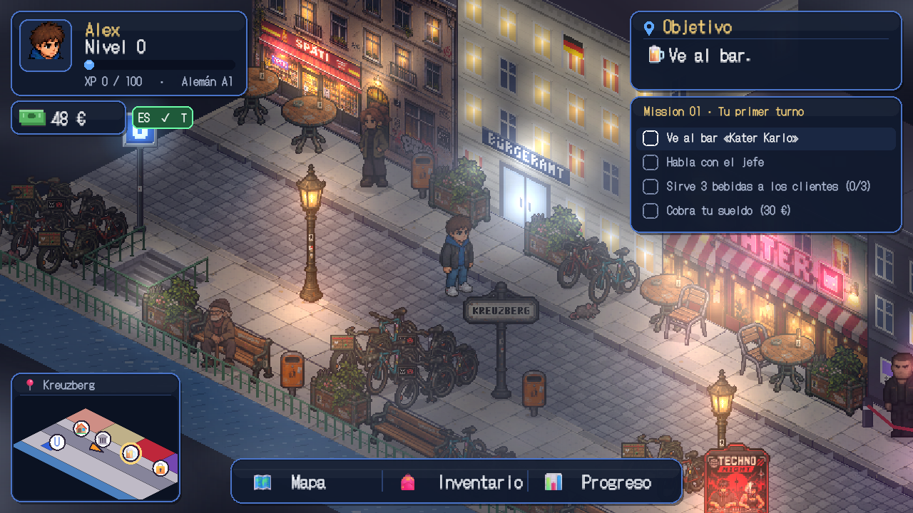

# BERLIN QUEST — Learn to Survive

An isometric pixel-art RPG for learning German (A1 → B2) by living in Berlin.



You arrive in Kreuzberg with €48 in your pocket. Land your first shift at the bar, register your address at
the Bürgeramt, set up your room in the WG and ride the U-Bahn to Alexanderplatz, all while speaking German.

## Getting started

Built with **Phaser 3 + TypeScript + Vite**.

```bash
npm install
npm run dev        # Phaser game:           http://localhost:5173/
                   # classic React version: http://localhost:5173/classic.html
npm run build
```

## Controls

| Key | Action |
|---|---|
| WASD / arrow keys | Walk (Shift = run) |
| E / Space | Interact, advance dialogue, choose |
| 1–5, ↑↓, Enter | Pick an answer or a drink |
| M · I · P | Map · Inventory · Progress |
| T | Show/hide translations |
| ESC | Pause (level A1–B2, voice, name, restart) |

On touch screens, a virtual joystick and an E button appear.

## Phaser game (`src/game/`)

```
src/game/
├── main.ts              Phaser config (pixelArt, RESIZE scaling)
├── iso.ts               2:1 isometric projection; the world is simulated in Cartesian coordinates
├── art/                 Pixel art generated in code at startup
│   ├── characters.ts      48×88 avatars · 20 frames (front/back × idle/walk/carry/sit)
│   ├── buildings.ts       Isometric facades (windows, balconies, neon, signs) and generic boxes
│   ├── props.ts           Street lamps, trees, bikes, BSR bins, Litfaßsäule, bar furniture, drinks
│   ├── tiles.ts           Cobblestones, slabs, wood, water… painted in (u, v) tile coordinates
│   └── palette.ts · font.ts · pixel.ts
├── scenes/
│   ├── BootScene.ts       Generates textures and animations
│   ├── WorldScene.ts      Base: movement, collisions, camera, E interaction, lights
│   ├── StreetScene.ts     Kreuzberg street: bar, Bürgeramt, U-Bahn, club, canal, NPCs
│   ├── BarScene.ts        Bar interior and the "Your first shift" mission
│   └── UIScene.ts         HUD, minimap, speech bubbles, dialogues, fridge, panels, pause
├── world/               Actor (animated sprite + depth), NPC brains, collisions + A*
├── data/bar.ts          Drinks, orders by CEFR level, German dialogues
└── state/GameState.ts   XP, money, vocabulary (SRS from src/engine), mission, local save
```

### Art direction (isometric "social sim" style)

- **64×32** tiles and **48×88** px avatars (frames), big heads and dark outlines.
- Camera zoom in 0.5 steps (2× at 1600×900) so characters stay readable.
- Pastel sunset palette: three tones per isometric face (light roof, mid facade, dark side).
- Font: **DotGothic16** (OFL, via `@fontsource/dotgothic16`, served locally): crisp pixel type
  with unambiguous "ß", umlauts and "€". Sizes are multiples of 4 (16/20/24/28 px).
  Phaser's `letterSpacing` is not used: it draws letter by letter and breaks emoji and glyphs.

### External sprites (hand-made PNGs)

- **Where the protagonist goes:** `public/assets/characters/player.png` (format and sizes in
  `public/assets/characters/README.md`: transparent 960×88 PNG, 20 frames of 48×88).
- **Test it without touching the game:** `npm run dev` and open http://localhost:5173/sprite-test.html
  (20 frames with foot, hand, portrait and speech-bubble markers; 4 directions; walk with WASD;
  you can also drag in a PNG).
- **Enable it in the game:** in `public/assets/manifest.json` set `"enabled": true` on `player`.
  While it is `false`, the game keeps using the procedural art.
- **Automatic fallback:** if the PNG is missing or isn't 960×88, `BootScene` logs a warning and generates
  the procedural art. Code: `src/game/art/sprites.ts` and `src/game/scenes/BootScene.ts`.

### Replacing procedural art with drawn spritesheets

Every texture is registered in `BootScene` under a stable key (`player`, `mehmet`, `lamp`, `tree0`,
`drink_bier`, `tile_cobble_0`…). To use hand-made art, just load a PNG with the same key and the same
frame layout (characters: 20 frames of 48×88 in one row; see `art/characters.ts`).

## Classic version (React, `classic.html`)

Dialogue-driven Bürgeramt mission, SRS review and a progress panel.

### Architecture

```
src/
├── engine/            Engine (no React): pure, testable logic
│   ├── types.ts         Types: player, dialogue nodes, missions, SRS…
│   ├── state.ts         Game reducer + automatic achievement checks
│   ├── dialogue.ts      Per-level text resolution, conditions, session effects
│   ├── evaluate.ts      Grading: cloze, rule-based free writing, spelling
│   ├── srs.ts           Spaced repetition (simplified SM-2)
│   ├── progression.ts   XP, levels, skill ranks, unlocks
│   ├── storage.ts       localStorage saves, migration, export/import
│   └── npc/provider.ts  NPC conversation interface (scripted; AI-ready)
├── data/              Learning content (data only)
│   ├── missions/        buergeramt.ts (playable), upcoming.ts (bar, WG, club)
│   ├── vocabulary.ts    Vocabulary with article, plural, example and level
│   └── locations, items, achievements, countries, backgrounds
├── screens/           Screens (welcome, character creation, map, mission, vocabulary, progress)
└── components/        Reusable UI (avatar, transcript, answer panels…)
```

## Adding a mission

1. Create `src/data/missions/<id>.ts` with a `Mission` object and its list of nodes.
2. Node types: `npc`, `narration`, `choice`, `cloze`, `free`, `spell`, `branch`, `end`.
3. Texts accept per-level variants: `{ A1: '…', B1: '…' }` (the highest one ≤ the player's level is used).
4. Register it in `src/data/missions/index.ts` and link it from `locations.ts`.

Free-writing rules (`FreeRule`) receive the text lowercased, without punctuation and with umlauts
transliterated (`ü → ue`, `ß → ss`).

## AI for NPCs

`NpcConversationProvider` (in `engine/npc/provider.ts`) receives the node (goal, rules, model answers),
the player's text and the context, and returns the NPC's reply plus the evaluation. Today it uses
`scriptedProvider` (offline). An LLM-backed provider can implement the same interface and fall back to
the scripted one if it fails.
